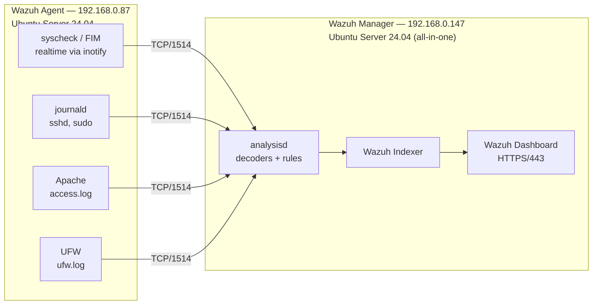

# Wazuh HIDS Lab — HIDS Deployment and Customization

[🇧🇷 Português](README.md) | 🇺🇸 English

A **HIDS (Host-based Intrusion Detection System)** lab built on [Wazuh](https://wazuh.com) 4.14: deployment of a Manager + Agent architecture, **11 custom detection rules** and a **custom decoder**, each rule validated with a controlled attack.

> Coursework for **Network Security** — Associate Degree (CST) in Computer Networks, Federal University of Santa Maria (UFSM), Colégio Técnico Industrial de Santa Maria. Prof. Tiago Rizzetti. April 2026.

## Goals

- Install and configure the Wazuh Manager and the Wazuh Agent on two separate virtual machines.
- Implement 11 custom rules covering **file integrity monitoring (FIM)**, **authentication** and **web attacks / reconnaissance**.
- Validate each rule with a controlled attack or action against the agent.
- Show, through the dashboard alerts, that detection came from the custom rules and not from Wazuh's generic ones.

## Architecture

Two VirtualBox VMs with bridged networking, on the same subnet as the host.



| Component | IP | Role |
|---|---|---|
| Wazuh Manager | `192.168.0.147` | Receives events, applies decoders and rules, stores alerts in the Indexer and serves the dashboard |
| Wazuh Agent (`Victor`, ID 001) | `192.168.0.87` | Collects logs (journald, Apache, UFW), monitors file integrity in real time and forwards events to the Manager |

## Custom rules

File: [`manager/rules/local_rules.xml`](manager/rules/local_rules.xml) (rule descriptions are in Portuguese)

| Rule | ID | Level | Module | Detects | Based on |
|---|---|---|---|---|---|
| R1 | 100001 | 15 | FIM | Change to `/etc/passwd` | SIDs 550, 553, 554 |
| R2 | 100002 | 12 | FIM | Hidden file (name starting with `.`) created in `/tmp` or `/var/www/html` | SID 554 |
| R3 | 100003 | 14 | FIM | Log file modified under `/var/log/` (e.g. a wiped log), a sign of defense evasion | SIDs 550, 552 |
| R4 | 100004 | 12 | FIM | `777` permission set on a file in `/var/www/html` | SIDs 550, 553 |
| R5 | 100005 | 12 | Authentication | SSH brute force: 5 failures within 120 s from the same IP | SID 5710 + `same_source_ip` |
| R6 | 100006 | 10 | Authentication | Successful SSH login between 00:00 and 06:00 | SID 5715 + `<time>` |
| R7 | 100007 | 10 | Authentication | 3 consecutive failed `sudo` attempts | SID 5404 |
| R8 | 100008 | 12 | Web | SQL injection in the Apache `access.log` | `accesslog` group + PCRE2 |
| R9 | 100009 | 12 | Web | Path traversal / LFI targeting `etc/passwd` | `accesslog` group + PCRE2 |
| R10 | 100010 | 12 | Web | Cross-site scripting (XSS) | `accesslog` group + PCRE2 |
| R11 | 100011 | 10 | Reconnaissance | Port scan: 20 UFW blocks within 60 s from the same IP | helper rule 100020 + `same_source_ip` |

**Rule 100020** is a helper: it classifies `[UFW BLOCK]` events so R11 can correlate them by frequency.

### Custom decoder

File: [`manager/decoders/local_decoder.xml`](manager/decoders/local_decoder.xml)

The default kernel log decoder does not extract the source IP from `[UFW BLOCK]` events. Without a `srcip` field, R11's `same_source_ip` cannot group events and the threshold is never reached. The `ufw-block` decoder is a child of the `kernel` decoder (`<parent>kernel</parent>`) and maps the `SRC=` value to `srcip`.

## Results

**All 11 rules produced verified alerts on the Wazuh dashboard.** Two of them (R4 and R11) only worked after adjustments found during testing.

| Rule | Test performed | Evidence |
|---|---|---|
| R1 | `useradd` of a test user | [screenshot](docs/img/r01.jpg) |
| R2 | creating `/tmp/.payload.sh` | [screenshot](docs/img/r02.jpg) |
| R3 | wiping `/var/log/auth.log` | [screenshot](docs/img/r03.jpg) |
| R4 | `chmod 777` on `/var/www/html/index.html` | [screenshot](docs/img/r04.jpg) |
| R5 | SSH attempts with wrong credentials | [screenshot](docs/img/r05.jpg) |
| R6 | SSH login with the VM clock set between 00:00 and 06:00 | [screenshot](docs/img/r06.jpg) |
| R7 | 3 wrong `sudo` passwords | [screenshot](docs/img/r07.jpg) |
| R8 | request containing `' OR '1'='1` | [screenshot](docs/img/r08.jpg) |
| R9 | request containing `../../../../../../etc/passwd` | [screenshot](docs/img/r09.jpg) |
| R10 | request containing `<script>alert(...)</script>` | [screenshot](docs/img/r10.jpg) |
| R11 | `nmap -sS` from the Manager | [screenshot](docs/img/r11.jpg) |

Step-by-step tests and the key fields of each alert are in [docs/en/validation.md](docs/en/validation.md).

## Documentation

- [Installation and configuration](docs/en/installation.md)
- [Rule validation](docs/en/validation.md)
- [Challenges and lessons learned](docs/en/troubleshooting.md)

## Repository layout

```
wazuh-hids-lab/
├── agent/
│   └── ossec.conf                  # agent config (/var/ossec/etc/ossec.conf)
├── manager/
│   ├── rules/local_rules.xml       # custom rules (/var/ossec/etc/rules/)
│   └── decoders/local_decoder.xml  # ufw-block decoder (/var/ossec/etc/decoders/)
└── docs/
    ├── pt-br/                      # documentação em português
    ├── en/                         # documentation in English
    └── img/                        # dashboard evidence (r01–r11)
```

> **Note:** `agent/ossec.conf` points to the lab Manager (`192.168.0.147`). Change `<client><server><address>` to match your environment.

## References

- [Wazuh documentation](https://documentation.wazuh.com)
- [Wazuh — Ruleset / Custom rules](https://documentation.wazuh.com/current/user-manual/ruleset/)
- [OWASP — SQL Injection](https://owasp.org/www-community/attacks/SQL_Injection)
- [UFW — Ubuntu Manpage](https://manpages.ubuntu.com/manpages/ufw.8.html)

---

**Author:** Victor de Menezes — [LinkedIn](https://www.linkedin.com/in/victordmnzs/)
