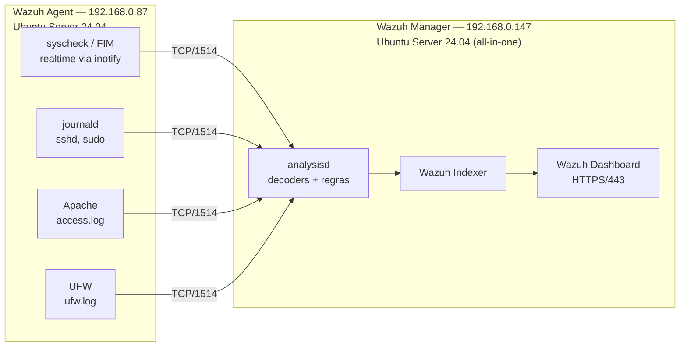

# Wazuh HIDS Lab — Implantação e Customização de HIDS

🇧🇷 Português | [🇺🇸 English](README.en.md)

Laboratório de **HIDS (Host-based Intrusion Detection System)** com [Wazuh](https://wazuh.com) 4.14: implantação da arquitetura Manager + Agent, criação de **11 regras de detecção customizadas** e de um **decoder próprio**, e validação de cada regra com ataques controlados.

> Trabalho da disciplina de **Segurança de Redes** — CST em Redes de Computadores, Universidade Federal de Santa Maria (UFSM), Colégio Técnico Industrial de Santa Maria. Prof. Tiago Rizzetti. Abril de 2026.

## Objetivos

- Instalar e configurar o Wazuh Manager e o Wazuh Agent em duas máquinas virtuais distintas.
- Implementar 11 regras customizadas cobrindo **integridade de arquivos (FIM)**, **autenticação** e **ataques web/reconhecimento**.
- Validar cada regra com um ataque ou ação controlada contra o agente.
- Comprovar, pelos alertas no dashboard, que a detecção veio das regras customizadas e não das regras genéricas do Wazuh.

## Arquitetura

Duas VMs no VirtualBox, com rede em modo bridge, na mesma sub-rede do host.



| Componente | IP | Função |
|---|---|---|
| Wazuh Manager | `192.168.0.147` | Recebe os eventos, aplica decoders e regras, armazena os alertas no Indexer e serve o dashboard |
| Wazuh Agent (`Victor`, ID 001) | `192.168.0.87` | Coleta logs (journald, Apache, UFW), monitora integridade de arquivos em tempo real e envia os eventos ao Manager |

## Regras customizadas

Arquivo: [`manager/rules/local_rules.xml`](manager/rules/local_rules.xml)

| Regra | ID | Nível | Módulo | O que detecta | Base |
|---|---|---|---|---|---|
| R1 | 100001 | 15 | FIM | Alteração em `/etc/passwd` | SIDs 550, 553, 554 |
| R2 | 100002 | 12 | FIM | Arquivo oculto (nome iniciado por `.`) criado em `/tmp` ou `/var/www/html` | SID 554 |
| R3 | 100003 | 14 | FIM | Arquivo de log modificado em `/var/log/` (ex.: log esvaziado), indício de evasão de defesa | SIDs 550, 552 |
| R4 | 100004 | 12 | FIM | Permissão `777` aplicada a arquivo em `/var/www/html` | SIDs 550, 553 |
| R5 | 100005 | 12 | Autenticação | Força bruta SSH: 5 falhas em 120 s do mesmo IP | SID 5710 + `same_source_ip` |
| R6 | 100006 | 10 | Autenticação | Login SSH bem-sucedido entre 00h e 06h | SID 5715 + `<time>` |
| R7 | 100007 | 10 | Autenticação | 3 falhas consecutivas de `sudo` | SID 5404 |
| R8 | 100008 | 12 | Web | SQL Injection no `access.log` do Apache | grupo `accesslog` + PCRE2 |
| R9 | 100009 | 12 | Web | Path Traversal / LFI mirando `etc/passwd` | grupo `accesslog` + PCRE2 |
| R10 | 100010 | 12 | Web | Cross-Site Scripting (XSS) | grupo `accesslog` + PCRE2 |
| R11 | 100011 | 10 | Reconhecimento | Port scan: 20 bloqueios do UFW em 60 s do mesmo IP | regra auxiliar 100020 + `same_source_ip` |

A **regra 100020** é auxiliar: classifica os eventos `[UFW BLOCK]` para que a R11 possa correlacioná-los por frequência.

### Decoder customizado

Arquivo: [`manager/decoders/local_decoder.xml`](manager/decoders/local_decoder.xml)

O decoder padrão de logs do kernel não extrai o IP de origem dos eventos `[UFW BLOCK]`. Sem o campo `srcip`, o `same_source_ip` da R11 não agrupa os eventos e o limiar nunca é atingido. O decoder `ufw-block` é filho do decoder `kernel` (`<parent>kernel</parent>`) e extrai o valor de `SRC=` para `srcip`.

## Resultados

**As 11 regras geraram alertas comprovados no dashboard do Wazuh.** Duas delas (R4 e R11) só funcionaram depois de ajustes identificados durante os testes.

| Regra | Teste executado | Evidência |
|---|---|---|
| R1 | `useradd` de um usuário de teste | [print](docs/img/r01.jpg) |
| R2 | criação de `/tmp/.payload.sh` | [print](docs/img/r02.jpg) |
| R3 | esvaziamento de `/var/log/auth.log` | [print](docs/img/r03.jpg) |
| R4 | `chmod 777` em `/var/www/html/index.html` | [print](docs/img/r04.jpg) |
| R5 | tentativas de SSH com credenciais erradas | [print](docs/img/r05.jpg) |
| R6 | login SSH com o relógio da VM entre 00h e 06h | [print](docs/img/r06.jpg) |
| R7 | 3 senhas erradas no `sudo` | [print](docs/img/r07.jpg) |
| R8 | requisição com `' OR '1'='1` | [print](docs/img/r08.jpg) |
| R9 | requisição com `../../../../../../etc/passwd` | [print](docs/img/r09.jpg) |
| R10 | requisição com `<script>alert(...)</script>` | [print](docs/img/r10.jpg) |
| R11 | `nmap -sS` a partir do Manager | [print](docs/img/r11.jpg) |

O passo a passo de cada teste e os campos principais de cada alerta estão em [docs/pt-br/validacao.md](docs/pt-br/validacao.md).

## Documentação

- [Instalação e configuração](docs/pt-br/instalacao.md)
- [Validação das regras](docs/pt-br/validacao.md)
- [Dificuldades encontradas e lições aprendidas](docs/pt-br/dificuldades.md)

## Estrutura do repositório

```
wazuh-hids-lab/
├── agent/
│   └── ossec.conf                  # config do agente (/var/ossec/etc/ossec.conf)
├── manager/
│   ├── rules/local_rules.xml       # regras customizadas (/var/ossec/etc/rules/)
│   └── decoders/local_decoder.xml  # decoder ufw-block (/var/ossec/etc/decoders/)
└── docs/
    ├── pt-br/                      # documentação em português
    ├── en/                         # documentation in English
    └── img/                        # evidências do dashboard (r01–r11)
```

> **Atenção:** o `agent/ossec.conf` aponta para o Manager do laboratório (`192.168.0.147`). Ajuste o endereço em `<client><server><address>` para o seu ambiente.

## Referências

- [Documentação oficial do Wazuh](https://documentation.wazuh.com)
- [Wazuh — Ruleset / Custom rules](https://documentation.wazuh.com/current/user-manual/ruleset/)
- [OWASP — SQL Injection](https://owasp.org/www-community/attacks/SQL_Injection)
- [UFW — Ubuntu Manpage](https://manpages.ubuntu.com/manpages/ufw.8.html)

---

**Autor:** Victor de Menezes — [LinkedIn](https://www.linkedin.com/in/victordmnzs/)
