# Rule validation

[← Back to README](../../README.en.md) · [Português](../pt-br/validacao.md)

Each rule was validated with a controlled test against the agent (`192.168.0.87`) and the alert was checked on the Wazuh dashboard. For each rule you will find the test command, the dashboard screenshot and the key fields of the resulting alert. Rule descriptions inside the alerts are in Portuguese, as written in the rules file.

**Contents:** [Module A — FIM](#module-a--file-integrity-monitoring-fim) · [Module B — Authentication](#module-b--log-analysis-and-authentication) · [Module C — Web and scans](#module-c--web-exploits-and-scans)

---

## Module A — File Integrity Monitoring (FIM)

### R1 — Critical change to `/etc/passwd` (level 15)

Rule 100001 flags any change to `/etc/passwd` at the highest severity. The `syscheck.path` field is matched against the literal value `/etc/passwd`, and the rule is anchored on syscheck events 550, 553 and 554.

```bash
sudo useradd testuser
```

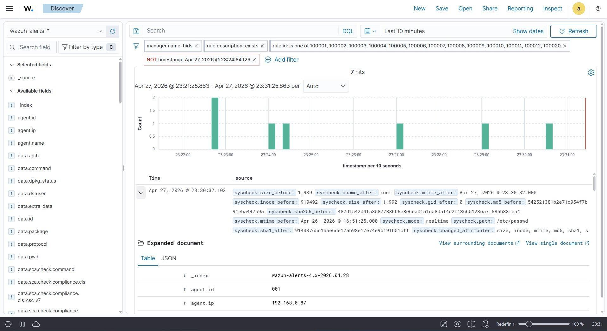

```json
{
  "rule.id": "100001",
  "rule.level": 15,
  "rule.description": "CUSTOM CRITICO [R1]: Arquivo /etc/passwd foi modificado!",
  "agent.ip": "192.168.0.87",
  "agent.name": "Victor",
  "syscheck.path": "/etc/passwd",
  "syscheck.event": "modified",
  "syscheck.changed_attributes": ["size","inode","mtime","md5","sha1","sha256"],
  "syscheck.perm_after": "rw-r--r--",
  "timestamp": "2026-04-28T02:30:32.102+0000"
}
```

### R2 — Hidden file in a sensitive directory (level 12)

Rule 100002 fires when syscheck detects the creation (event 554) of a file whose name starts with `.` in `/tmp` or `/var/www/html`. The check is a PCRE2 regex on the file path.

```bash
touch /tmp/.payload.sh
```

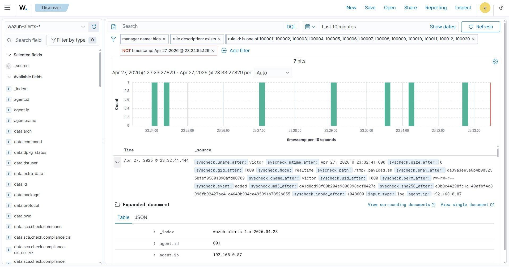

```json
{
  "rule.id": "100002",
  "rule.level": 12,
  "rule.description": "CUSTOM [R2]: Arquivo oculto criado em diretorio sensivel (possivel malware)",
  "agent.ip": "192.168.0.87",
  "agent.name": "Victor",
  "syscheck.path": "/tmp/.payload.sh",
  "syscheck.event": "added",
  "syscheck.perm_after": "rw-rw-r--",
  "timestamp": "2026-04-28T02:32:41.444+0000"
}
```

### R3 — Defense evasion: wiped log (level 14)

Rule 100003 detects changes to files under `/var/log/`, a technique attackers use to erase traces of their presence. Wiping a file with a redirect (`>`) shows up as a checksum change, with the size dropping from 32 bytes to 0.

```bash
sudo sh -c '> /var/log/auth.log'
```

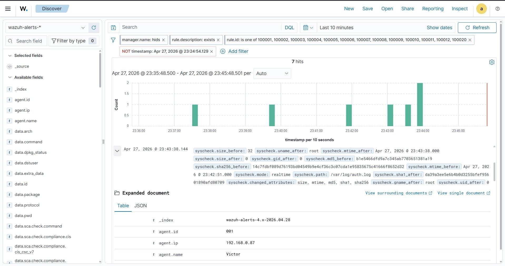

```json
{
  "rule.id": "100003",
  "rule.level": 14,
  "rule.description": "CUSTOM CRITICO [R3]: Arquivo de log deletado/modificado - Evasao de Defesa!",
  "agent.ip": "192.168.0.87",
  "syscheck.path": "/var/log/auth.log",
  "syscheck.event": "modified",
  "syscheck.size_before": "32",
  "syscheck.size_after": "0",
  "syscheck.changed_attributes": ["size","mtime","md5","sha1","sha256"],
  "timestamp": "2026-04-28T02:43:38.144+0000"
}
```

### R4 — 777 permission in `/var/www/html` (level 12)

Rule 100004 watches attribute changes on files in `/var/www/html` and fires when the resulting permission is `rwxrwxrwx` (777). For this test, when the `chmod` runs relative to the agent's startup matters (see [troubleshooting](troubleshooting.md#r4--real-time-syscheck-timing)).

```bash
sudo chmod 777 /var/www/html/index.html
```

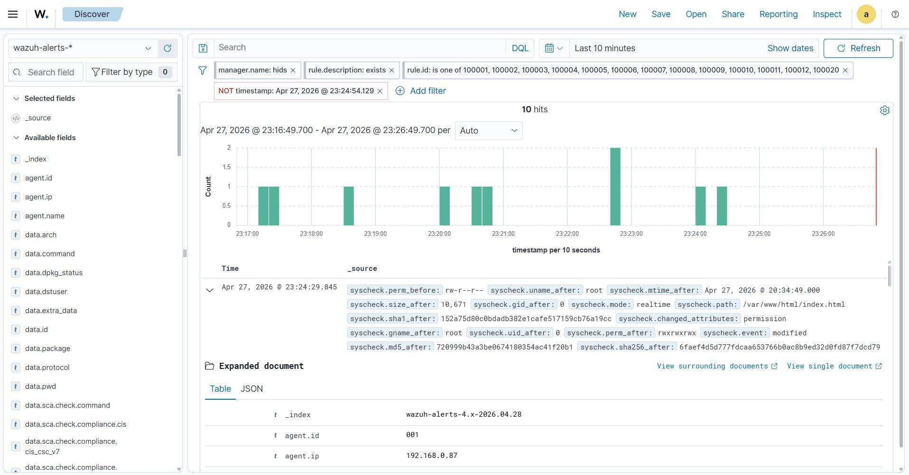

```json
{
  "rule.id": "100004",
  "rule.level": 12,
  "rule.description": "CUSTOM [R4]: Permissao 777 detectada em arquivo de /var/www/html",
  "agent.ip": "192.168.0.87",
  "syscheck.path": "/var/www/html/index.html",
  "syscheck.event": "modified",
  "syscheck.perm_before": "rw-r--r--",
  "syscheck.perm_after": "rwxrwxrwx",
  "syscheck.changed_attributes": ["permission"],
  "timestamp": "2026-04-28T02:24:29.845+0000"
}
```

---

## Module B — Log analysis and authentication

### R5 — SSH brute force: 5 failures in 120 s (level 12)

Rule 100005 uses Wazuh's frequency correlation (`frequency="5" timeframe="120"`) on SID 5710 (invalid SSH user), grouping events by source IP with `same_source_ip`. The test was done manually by attempting SSH with wrong credentials.

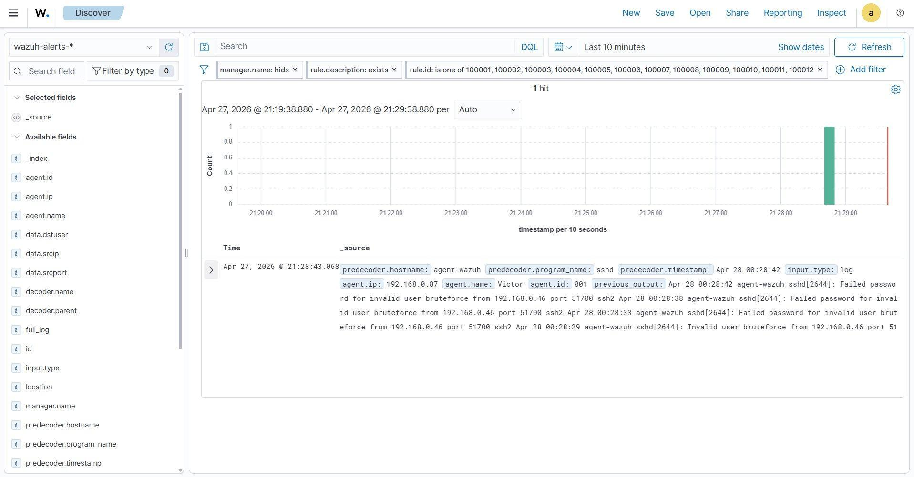

```json
{
  "rule.id": "100005",
  "rule.level": 12,
  "rule.description": "CUSTOM [R5]: Forca Bruta SSH - 5 falhas em 120s do mesmo IP",
  "rule.frequency": 5,
  "agent.ip": "192.168.0.87",
  "data.srcip": "192.168.0.46",
  "data.dstuser": "bruteforce",
  "data.srcport": "51700",
  "full_log": "sshd: Failed password for invalid user bruteforce from 192.168.0.46 port 51700 ssh2",
  "timestamp": "2026-04-28T00:28:43.068+0000"
}
```

### R6 — SSH login outside business hours (level 10)

Rule 100006 watches successful SSH logins (SID 5715) and only fires between 00:00 and 06:00, using the `<time>` tag. For the test, the agent VM's clock had already been set inside that window.

```bash
ssh victor@192.168.0.87
```

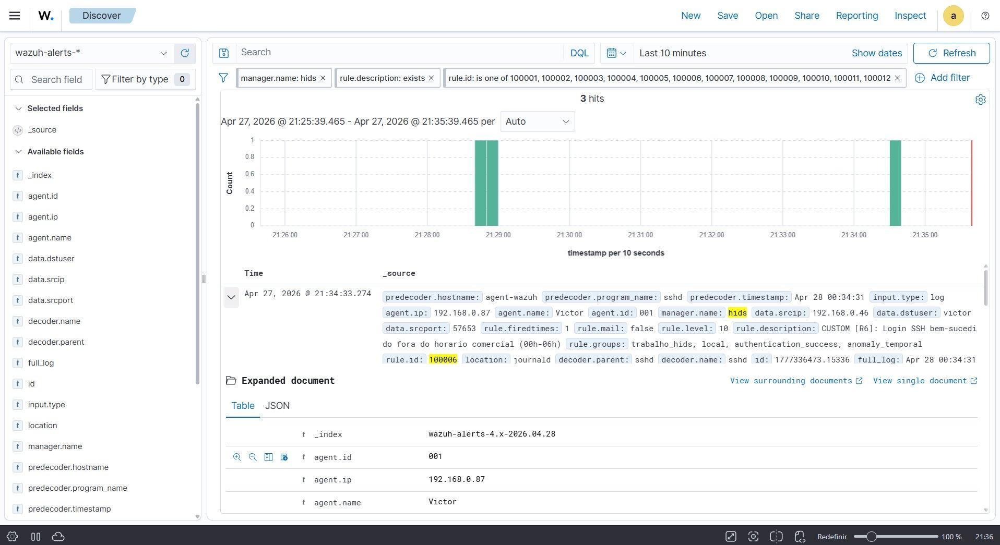

```json
{
  "rule.id": "100006",
  "rule.level": 10,
  "rule.description": "CUSTOM [R6]: Login SSH fora do horario comercial (00h-06h)",
  "agent.ip": "192.168.0.87",
  "data.srcip": "192.168.0.46",
  "data.dstuser": "victor",
  "data.srcport": "57653",
  "full_log": "sshd: Accepted password for victor from 192.168.0.46 port 57653 ssh2",
  "timestamp": "2026-04-28T00:34:33.274+0000"
}
```

### R7 — Privilege abuse: 3 failed sudo attempts (level 10)

Rule 100007 inherits from native SID 5404, which Wazuh already uses to log three incorrect `sudo` attempts. Since the dashboard showed that 5404 already does the counting, there was no need to rebuild the frequency correlation. The custom rule anchors on it to show the project's own description.

```bash
sudo su
# enter the wrong password 3 times
```

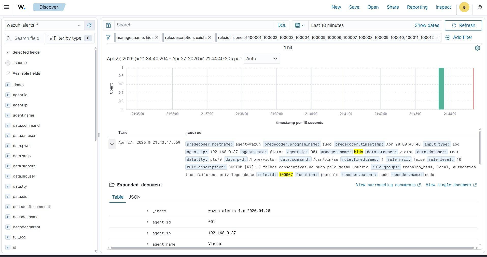

```json
{
  "rule.id": "100007",
  "rule.level": 10,
  "rule.description": "CUSTOM [R7]: 3 falhas consecutivas de sudo pelo mesmo usuario",
  "agent.ip": "192.168.0.87",
  "data.srcuser": "victor",
  "data.dstuser": "root",
  "data.command": "/usr/bin/su",
  "full_log": "sudo: victor : 3 incorrect password attempts ; TTY=pts/0 ; USER=root ; COMMAND=/usr/bin/su",
  "timestamp": "2026-04-28T00:43:47.559+0000"
}
```

---

## Module C — Web exploits and scans

The web rules analyze the agent's `/var/log/apache2/access.log` through the `accesslog` group. The tests were launched from the Manager (`192.168.0.147`).

### R8 — SQL injection (level 12)

A PCRE2 regex that matches classic SQLi patterns such as `' OR '1'='1` and `UNION SELECT`, including URL-encoded variants.

```bash
curl "http://192.168.0.87/?login=' OR '1'='1"
```

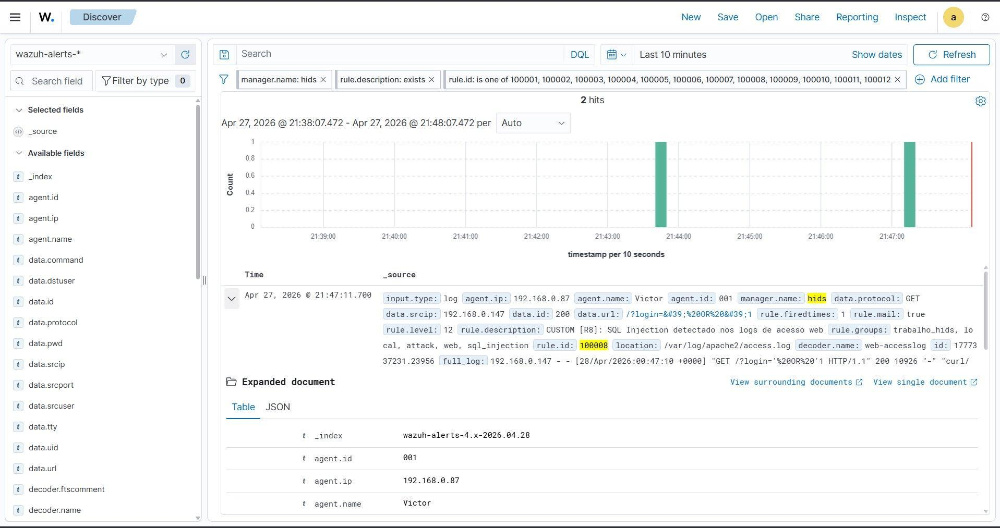

```json
{
  "rule.id": "100008",
  "rule.level": 12,
  "rule.description": "CUSTOM [R8]: SQL Injection detectado nos logs de acesso web",
  "agent.ip": "192.168.0.87",
  "data.srcip": "192.168.0.147",
  "data.protocol": "GET",
  "data.url": "/?login=' OR '1",
  "location": "/var/log/apache2/access.log",
  "full_log": "GET /?login='%20OR%20'1 HTTP/1.1 200",
  "timestamp": "2026-04-28T00:47:11.700+0000"
}
```

### R9 — Path traversal / LFI (level 12)

Detects directory traversal (`../`) combined with typical LFI targets such as `etc/passwd`. The regex covers both the literal form and URL-encoded variants (`%2e%2e%2f`).

```bash
curl "http://192.168.0.87/?pagina=../../../../../../etc/passwd"
```

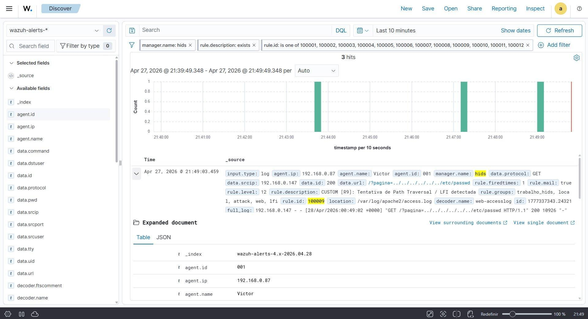

```json
{
  "rule.id": "100009",
  "rule.level": 12,
  "rule.description": "CUSTOM [R9]: Tentativa de Path Traversal / LFI detectada",
  "agent.ip": "192.168.0.87",
  "data.srcip": "192.168.0.147",
  "data.protocol": "GET",
  "data.url": "/?pagina=../../../../../../etc/passwd",
  "location": "/var/log/apache2/access.log",
  "full_log": "GET /?pagina=../../../../../../etc/passwd HTTP/1.1 200",
  "timestamp": "2026-04-28T00:49:03.459+0000"
}
```

### R10 — Cross-site scripting (level 12)

Detects script injection through the URL: `<script>`, `javascript:` and event handlers such as `onerror=` and `onload=`. In the rule XML, `<` had to be written as `&lt;`. In the first version of the file, this crashed `analysisd`.

```bash
curl "http://192.168.0.87/?busca=<script>alert('Hackeado')</script>"
```

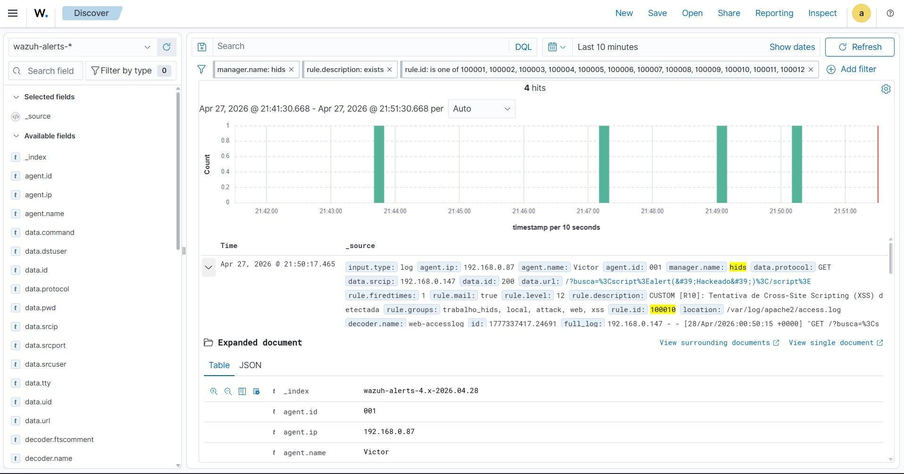

```json
{
  "rule.id": "100010",
  "rule.level": 12,
  "rule.description": "CUSTOM [R10]: Tentativa de Cross-Site Scripting (XSS) detectada",
  "agent.ip": "192.168.0.87",
  "data.srcip": "192.168.0.147",
  "data.protocol": "GET",
  "data.url": "/?busca=%3Cscript%3Ealert('Hackeado')%3C/script%3E",
  "location": "/var/log/apache2/access.log",
  "full_log": "GET /?busca=%3Cscript%3Ealert('Hackeado')%3C/script%3E HTTP/1.1 200",
  "timestamp": "2026-04-28T00:50:17.465+0000"
}
```

### R11 — Port scan via UFW (level 10)

Rule 100011 correlates 20 or more UFW blocks from the same IP within 60 seconds. It depends on two extra settings: UFW enabled with logging on the agent, and the custom `ufw-block` decoder that extracts `srcip` (see [troubleshooting](troubleshooting.md#r11--custom-decoder-for-the-ufw-srcip)).

```bash
# run from the Manager (192.168.0.147)
sudo nmap -sS 192.168.0.87
```

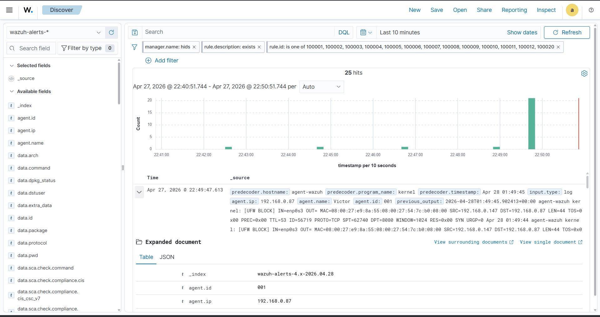

```json
{
  "rule.id": "100011",
  "rule.level": 10,
  "rule.description": "CUSTOM [R11]: Possivel varredura de portas (Port Scan) detectada",
  "rule.frequency": 20,
  "agent.ip": "192.168.0.87",
  "data.srcip": "192.168.0.147",
  "previous_output": "[UFW BLOCK] SRC=192.168.0.147 DPT=8080 | DPT=113 | DPT=21 | DPT=3306 | DPT=22 | DPT=554 ...",
  "timestamp": "2026-04-28T01:49:47.613+0000"
}
```
